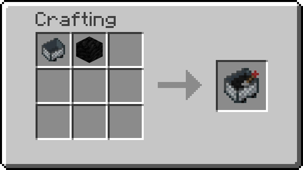
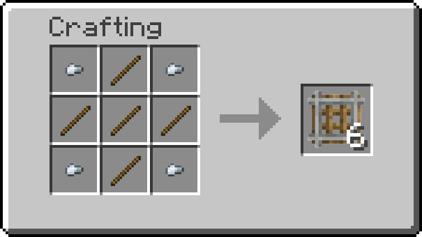
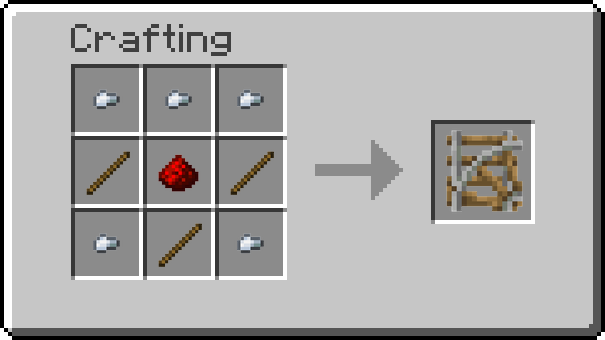
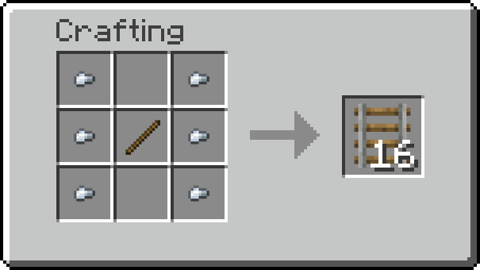
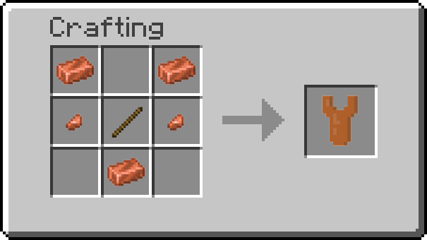

# PolyTrains
TODO: create and insert mod icon (centered)

A server-side Fabric mod that adds a ton of new rail mechanics and makes minecarts not suck.
Inspired by Cammie's Minecart Tweaks.

## Features

### Trains
Link carts together with iron chains and a wrench to form a train. All carts move together,
but longer trains are harder to move. Use furnace minecarts to power them.
The more furnace carts are in a train, the faster it accelerates.

### Furnace Cart Improvements
The furnace cart now accepts any fuel that would work in a normal furnace, including lava!
You can keep dumping fuel into it (up to `furnace_max_burn_time`) to make it run longer.
It can be stopped, by using an (unpowered) powered rail, or the new brake lever.

#### Coal Tender Minecart

When linked directly to a furnace cart and filled with coal or charcoal, it keeps the furnace cart fuelled.

### Collision
With `realistic_physics` on, trains break apart when they collide if they're going fast enough.
Mobs and players can get run over now too!

TODO: insert demonstration video

### More Rail Types
- **Junction rail** - a fixed crossing, letting two lines cross over eachother without joining.

  

- **Switch rail** - a t-shaped rail that switches between two directions with redstone.

  

### Cheaper Rails
All rails use nuggets instead of ingots to make minecarts a viable early to mid-game method of transportation.

## Usage

Trains can be linked together using the new wrench item, which uses an iron chain from your inventory when linking two carts together.
You can also change the default direction of a switch rail by using the wrench on it.

TODO: insert train demonstration video

## Configuration

Everything is done with `sstrains:` gamerules:

| Key [default value] | Description |
| --- | --- |
| `trains_enabled [true]` | Whether linking, following and chains work. Only exists if `minecart_improvements` is on. |
| `max_train_length [128]` | Maximum number of carts that can be linked together. |
| `minecart_damage [20]` | Scales the damage a moving cart deals, or 0 to disable. |
| `cart_impact_speed [4]` | Mobs/players take damage from a cart above this speed, in blocks per second. |
| `cart_wreck_momentum [4]`| Carts may break when they collide. Higher means less likely to break. Set to 0 to disable. Needs `realistic_physics`. |
| `cart_pickup_speed [4]` | The fastest a cart can be moving and safely pick up a mob, in blocks per second. |
| `carts_resume_from_brakes [true]` | Whether a cart stopped by an unpowered powered rail leaves again when the signal returns. |
| `realistic_physics [false]` | Use a realistic force model instead of vanilla minecart physics. Off by default. |
| `furnaces_can_use_all_fuels [true]` | Whether furnace carts accept all furnace fuels. |
| `furnace_max_burn_time [72000]` | Furnace burn time ceiling, in ticks. |
| `furnace_minecarts_load_chunks [false]` | Whether moving furnace carts act as chunkloaders. |

**Note:** This mod respects vanilla's `max_minecart_speed` gamerule.
You _can_ have trains that move at absurdly high speeds and, for the most part, they'll still work fine.
_However_, **there are some bugs that may exist** due to the difficulty in calculating train movement over multiple blocks in a single tick.
It is highly recommended that minecart speed not go above 40.

## Requirements

Trains require vanilla's `minecart_improvements` experimental datapack, which has to be turned on when the world is created.
If it's not enabled, a warning is logged at startup and the train-specific gamerules won't appear at all.
